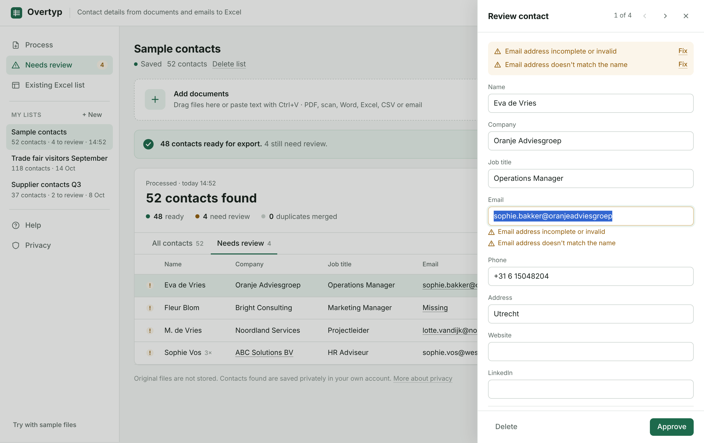
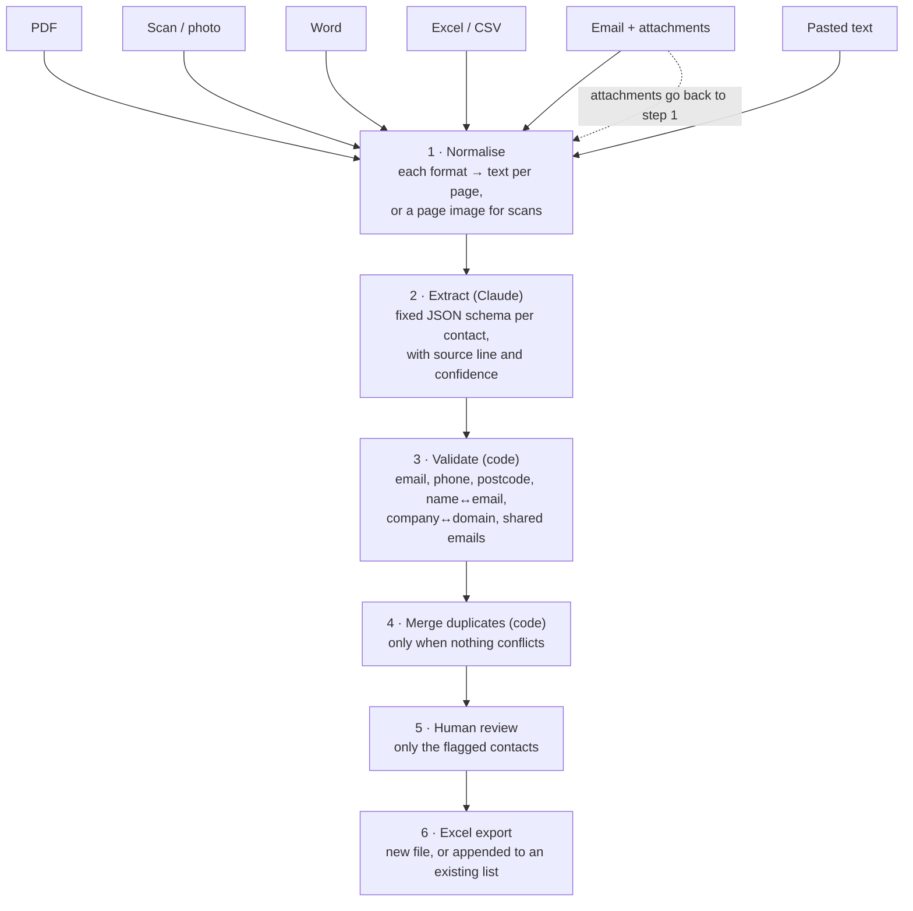

# Overtyp

**Turn contact details buried in PDFs, scans, Word files, spreadsheets and emails into a clean, checked Excel list.**

Overtyp reads the document, finds every contact person, normalises the data, flags what looks wrong, and lets an employee fix only those few cases before exporting to Excel.


---

## The problem

In office jobs someone regularly gets a participant list, a member list or a pile of forwarded emails, and has to type every name, company, email address and phone number into Excel, page by page. I have done this work myself. It is slow, error-prone, and nobody wants to do it.

The documents are never the same: tables, loose text, email signatures, scanned business cards. A fixed template or a few regular expressions break on the second document. That is where a language model helps.

## What it does

- **Any common input**: PDF (including scans), photos, Word, Excel/CSV, emails (`.eml`, `.msg`) and their attachments, or text pasted with Ctrl+V.
- **Extracts a fixed set of fields**: name, company, job title, email, phone, address, website, LinkedIn, plus the source line each contact came from.
- **Normalises**: phone numbers to `+31 6 12345678`, Dutch postcodes to `1234 AB`, names split into first name / prefix / last name in the export.
- **Flags what needs a human**, each with a reason: invalid or missing email, an email that doesn't match the person's name, a company that doesn't match the email domain, two different people sharing one email address, unrecognised phone numbers, text the model marked as hard to read.
- **Merges real duplicates** across files, but never silently merges records that contradict each other.
- **Review in one click**: click an underlined value and the side panel opens with that field selected. *Approve* jumps to the next case.
- **Exports to Excel**: a clean *Contacts* sheet plus a *Needs review* sheet for anything not yet checked. It can also append only the new contacts to an existing Excel list, in that list's own columns.
- **My lists**: every run is saved privately per user and can be reopened later to add more names.



## How it works



**Key design decision: the model only extracts; plain code decides what is trustworthy.** Validation and de-duplication are deterministic rules. They are predictable, free, unit-tested, and they catch the model's mistakes instead of trusting them. The model is also asked to mark its own uncertainty ("text cut off", "unclear which phone belongs to whom"), and those cases go to review too.

The employee never sees an "agent". They see: file in, Excel out, with a short check in between.

## Evaluation

The deterministic layer is tested against a 52-row test file ([`tests/fixtures/sample-contacts.pdf`](tests/fixtures/sample-contacts.pdf)) that contains four deliberate errors.

| Measure | Result |
| --- | --- |
| Rows read from the PDF | 52 of 52 |
| Planted errors flagged | 4 of 4 |
| Correct rows wrongly flagged | 0 |
| Rows wrongly merged | 0 |

The first version flagged **22 of 22** merged contacts, because it treated every person who appears more than once as a duplicate. That would have made the review step useless. [`docs/evaluation.md`](docs/evaluation.md) describes what went wrong, how it was fixed, and what has not been measured yet: live extraction accuracy on messy documents, and the time saved.

## Privacy by design

Contact details are personal data, so the app keeps as little as possible:

- Files are read in the browser. Original files are never uploaded or stored.
- Only the extracted text (or, for scans, the page image) is sent to Claude for recognition.
- Saved lists contain only the contact details found, stored per user. Nobody else can see them, including the app's owner. *Delete list* erases a list permanently.
- The Excel export is saved on the user's own computer.

## Running it

**Inside Claude (full functionality).** Overtyp runs as a published Claude artifact. In that environment the page can ask Claude to extract contacts through the viewer's own Claude account, store lists privately per user, and offer the Excel file for download.

**Locally or on GitHub Pages.** Open `index.html`. The example data, the review flow and the Excel export all work. AI extraction and saved lists need the Claude runtime; outside it the page says so. The [roadmap](docs/roadmap.md) describes the stand-alone version that calls the Claude API from its own server.

**Tests**

```bash
npm install
npm test
```

Nine tests cover PDF text extraction, the fixture result above, duplicate handling, phone and name normalisation, and email (MIME) parsing, including attachments.

## Tech

- Single-page app in plain HTML, CSS and JavaScript, with no build step
- [pdf.js](https://mozilla.github.io/pdf.js/) for PDFs, [mammoth](https://github.com/mwilliamson/mammoth.js) for Word, [SheetJS](https://sheetjs.com/) for Excel in and out
- An email (MIME) parser written from scratch for `.eml`, including quoted-printable, base64 and attachments
- Claude for extraction, with a strict JSON schema
- `node:test` + jsdom for tests

## Project structure

```
index.html                 the complete app
tests/app.test.mjs         automated tests
tests/fixtures/            test PDF and its ground truth
docs/evaluation.md         test results, iterations, what is not measured yet
docs/roadmap.md            from prototype to production
docs/screenshots/
```

## What I would do next

See [`docs/roadmap.md`](docs/roadmap.md). In short: a stand-alone web app that calls the Claude API from its own server, company login, EU data storage with a retention period, and an inbox address employees can forward emails to.

## License

[MIT](LICENSE)
